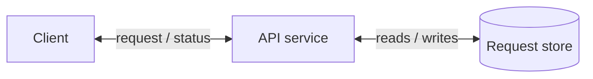

# Simplified
Always use the `/asd-ste100` skill.


# High-Level Design

Use a short, linear design process. Make the simplest complete design first. Technology-agnostic HLD, but not prototype-level of project/feature.

This skill adapts the public Hello Interview delivery structure (every point/structure should be for very core main fundamentals level of the project - so not to list all the detailed possible; just main core important): core entities, Core-main API/system interface, optional data flow, then high-level design. Do not reproduce its course material or presume its deep-dive recommendations apply to the user’s system.

### Technology-agnostic HLD

Do not select, compare, or name actual code-implementation-specific technologies in the diagram. Use capability (i.e. broad) names such as `database`, `object storage`, `event broker`, `cache`, `middleware`, `CI/CD pipeline`, and `application service, etc...`.

Keep explicitly given external systems as integration constraints, not as technology recommendations. For example, describe an existing identity provider as `existing company identity provider` unless its name is essential to the requested scope.

Very important: do not over-engineer or over-complicate the design, etc.: Avoid unnecessary components, complexity, or optimizations. Do not add a cache, queue, CDN, replica, retry mechanism, monitoring tool, or load balancer merely because it is common or to make the design look more fancy. Always think before doing any such thing, include if & only if really required.


Check the requirements & ask clarifying questions when the missing context is genuinely necessary to produce a correct design. Make and label reasonable assumptions when they do not materially affect the architecture.

## Identify the hardest parts

Before finalizing the architecture, identify the topmost few really hardest or most critical or most challenging parts of the product or application or the feature, if any really. Keep this list focused on the risks that require the most architectural judgment or could most seriously affect correctness/reliability/security/scale/or user experience; do not invent difficulty for its own sake.

For every challenging part:
- State why it is difficult or high-risk in this system.
---
If essential context is missing, ask a targeted clarifying question before committing to a design. If the user cannot provide it, state the assumption and how it affects the solution.

## Define the contract before drawing (if not initially discussed or in plan mode docs or anywhere such - else refer from there and mention in output)
- List only the very core-main-fundamental entities: actors & essential nouns/resources. Start with names, not a detailed schema.
-  Default to REST for an external CRUD-style interface or else you can think of other as well if necessary & suitable. State authentication & authorization at the boundary when access control is material (only if necessary/relevant/helpful).
- Use a short endpoint format for the main-core-fundamentals part (else no such content):
```text
POST /a/requests
body: { … } → { request_id, status }

GET /a/requests/{request_id} → Request
```

## Build the HLD incrementally
Build the architecture one functional requirement at a time.
1. Start with the request entry point, the service that owns the operation, and the minimal durable state it needs.
2. Trace one representative operation from request to response. Say what each component does and what state changes.
3. Add only the component required by the next core main fundamental operation.
4. Check that the resulting design satisfies the stated functional requirements & relevant non-functional requirements, etc.

Use capability names only. Technology selection belongs exclusively in text content (below/after diagram).

## Diagram standard

Prioritize readability over completeness. A diagram should make the primary path understandable in a few seconds.

- Create one overview diagram sized for readability. Do not impose a fixed maximum number of nodes or edges. Judge whether one coherent primary flow can still be traced quickly, with clear component ownership and without distracting crossings; if not, split distinct read/write, asynchronous, or lifecycle flows into separate diagrams.
- Default to left-to-right for HLD request flows. Use top-to-bottom only when a layered view or pipeline is clearer. Keep arrows straight and labels short verbs, for example `creates`, `reads`, `publishes`.
- Draw only components that have an active responsibility in the described flow. Do not add a cache, queue, CDN, replica, retry mechanism, monitoring tool, or load balancer merely because it is common.
- Do not draw every endpoint, table field, error path, authentication exchange, or future optimisation. Put relevant fields next to the data store only if they affect the design.
- Keep the diagram hierarchy flat. Avoid nested boxes, crossed arrows, circular arrows, and decorative nodes.
- Use a single connector with arrowheads at both ends only when really the two components genuinely exchange information that matters to the HLD: a status callback, a result that changes the initiator's next action, an approval or rejection, a stream, or a required acknowledgement. Do not make a connection bidirectional merely because a request-response protocol technically has a response.
- Give a bidirectional connector one short combined label, for example `request / status`, `reads / writes metadata`, or `stores / retrieves files`. Do not draw two opposing arrows for that same relationship.
- Draw at most one connector between the same two components in an overview diagram. Do not add a separate edge for each endpoint, CRUD action, or repeated operation. Collapse same-direction actions into one relationship label; move the exact actions into the primary-operation steps.
- If two independent relationships between the same components must be understood separately, use separate operation diagrams rather than multiple edges in the overview.
- Explain the primary flow below the diagram in 3–6 numbered steps. The prose carries precise behaviour; the diagram carries structure.

When Mermaid is useful, use this restrained baseline and replace names as needed:



Use plain prose plus a component table instead when Mermaid cannot express the result cleanly. Never force a large Mermaid diagram.

## Return format

Produce this order, omitting empty sections, depending on what is covered initially in chat - so skip relevant accordingly and mention it in chat:

1. **Core entities**
2. **Data flow**: only when it adds real-value
3. **High-level design**: one diagram
4. **Core components and responsibilities**: a short, simplified table
5. **Top Hardest / most challenging / most critical parts (without any solution)**: include the top few real challenges, if any.


## HLD boundary

Do not enter deep dives or tech-stack-specifics by default.